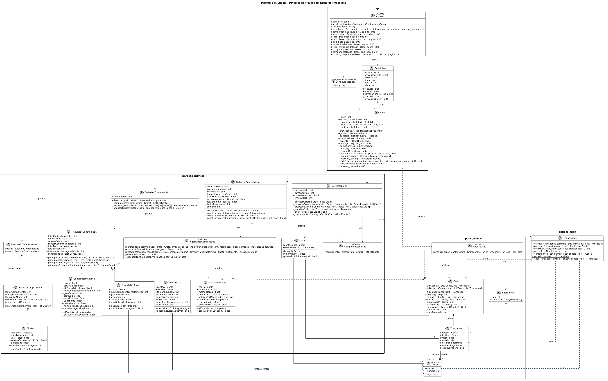
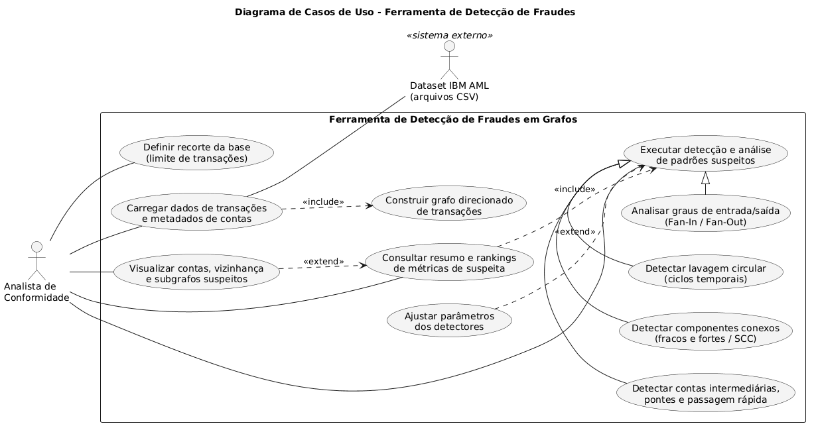

---

# 🔎 Detecção de Fraudes em Redes de Transações

> Ferramenta computacional baseada em Teoria dos Grafos para modelagem de redes financeiras e detecção de padrões suspeitos de lavagem de dinheiro, implementada integralmente do zero em Python sobre o dataset IBM AML.

<div align="justify">
  O projeto <b>Detecção de Fraudes em Redes de Transações</b> modela movimentações financeiras entre contas bancárias como um <i>multigrafo direcionado e temporal</i>, permitindo investigar conexões atípicas associadas à lavagem de dinheiro. Por meio de algoritmos clássicos de grafos implementados <b>sem bibliotecas prontas de processamento de grafos</b> (como NetworkX), a ferramenta identifica <b>ciclos de lavagem (layering)</b>, <b>contas atípicas de concentração e dispersão (Fan-In / Fan-Out)</b>, <b>clusters de contas (componentes fracos e fortes)</b> e <b>contas intermediárias ("laranjas"), vértices de corte e pontes estruturais</b>.
</div>

---

## 🚧 Status do Projeto

[](https://github.com/MatheusRuas77/Trabalho-Pratico-Grafos)
[]()
[](https://www.python.org/)
[]()

---

## 📚 Índice

- [Links Úteis](#-links-úteis)
- [Sobre o Projeto](#-sobre-o-projeto)
- [Funcionalidades Principais](#-funcionalidades-principais)
- [Tecnologias Utilizadas](#-tecnologias-utilizadas)
- [Instalação e Execução](#-instalação-e-execução)
- [Estrutura de Pastas](#-estrutura-de-pastas)
- [Modelagem e Demonstração](#-modelagem-e-demonstração)
- [Autores](#-autores)
- [Professor Responsável](#-professor-responsavel)
- [Contribuição](#-contribuição)
- [Licença](#-licença)

---

## 🔗 Links Úteis

* 🗂️ **Dataset (Kaggle):** _[IBM Transactions for Anti Money Laundering (AML)](https://www.kaggle.com/datasets/ealtman2019/ibm-transactions-for-anti-money-laundering-aml)_
* 🧩 **Diagrama de Classes:** [artefatos/01_classes.puml](artefatos/01_classes.puml)
* 📋 **Diagrama de Casos de Uso:** [artefatos/02_casos_de_uso.puml](artefatos/02_casos_de_uso.puml)
* 📄 **Relatório Técnico (Overleaf — SBC LaTeX):** _[Projeto no Overleaf](https://www.overleaf.com/project/6afb56401ef596cb713d7ba0)_

---

## 📝 Sobre o Projeto

Este projeto foi desenvolvido como Trabalho Prático da disciplina de **Teoria dos Grafos** (PUC Minas — ICEI), abordando o **Tema 6: Detecção de Fraudes em Redes de Transações**.

A proposta consiste em construir uma estrutura própria de multigrafo direcionado capaz de processar milhões de transações reais/sintéticas do dataset **IBM AML (`HI-Small_Trans.csv`, com 5.078.345 transações e 515.088 contas)**, com foco em:

- Modelar contas bancárias como **vértices** e transferências (com valor, moeda, instante, formato de pagamento e rótulo de lavagem) como **arestas direcionadas**
- Implementar algoritmos fundamentais de grafos **do zero**, respeitando a restrição de não utilizar bibliotecas prontas de grafos no processamento principal
- Avaliar desempenho, complexidade assintótica e aderência dos padrões detectados frente aos rótulos conhecidos de lavagem de dinheiro

---

## ✨ Funcionalidades Principais

- 📥 **Leitura e Construção do Grafo (`LeitorDados` e `Grafo`):** Carregamento otimizado de transações em CSV e padrões conhecidos (`LI-Large_Patterns.txt`) em listas de adjacência direta e transposta
- 🔄 **Detecção de Ciclos / Layering (`DetectorCiclos`):** Particionamento prévio em Componentes Fortemente Conexas (Tarjan iterativo) seguido de DFS limitada por comprimento com verificação opcional de ordem cronológica das transações
- 📈 **Análise de Grau — Contas Atípicas (`AnaliseGrau`):** Identificação de contas com concentração elevada de entradas (*Fan-In*) ou dispersão elevada de saídas (*Fan-Out*)
- 🧩 **Componentes Conexos / Clusters (`DetectorComponentes`):** Detecção de componentes fracamente e fortemente conexos (Tarjan iterativo), distribuição por tamanho, densidade interna, valores por moeda e incidência de transações rotuladas
- 🍊 **Centralidade — Contas "Laranjas" e Pontes (`DetectorCentralidade`):**
  - **Centralidade de Intermediação (*Betweenness*):** Algoritmo de Brandes (2001) direcionado com modo exato e modo amostrado por pivôs (*Brandes-Pich*) + limite de saltos, além de cálculo de razão de repasse separada por moeda
  - **Pontes e Pontos de Articulação:** Algoritmo de Tarjan iterativo em $O(|V| + |E|)$ identificando canais únicos entre sub-redes (com tamanho de cada lado e valores por moeda) e vértices de corte (gargalos que fragmentam a rede)
  - **Passagem Rápida Temporal (*Pass-Through*):** Janela deslizante por moeda (`intervaloMaximo` e `razaoMinimaRepasse`) em $O(|V| + |E| \log d_{\max})$ para detectar contas que recebem e repassam valores em intervalos curtos

---

## 🛠 Tecnologias Utilizadas

### ⚙️ Núcleo e Algoritmos

* **Linguagem:** Python 3.12+
* **Estrutura e Algoritmos de Grafos:** 100% implementação própria utilizando apenas a biblioteca padrão do Python (`csv`, `collections`, `dataclasses`, `datetime`, `heapq`, `logging`, `pathlib`, `random`, `time`)
* **Conformidade com o TP:** Nenhuma biblioteca pronta de grafos (como NetworkX ou igraph) é utilizada na criação ou processamento do grafo

### 📐 Modelagem e Documentação

* **Diagramas UML:** PlantUML (`.puml` / `.png`)
* **Relatório Técnico:** LaTeX (formato oficial da SBC)

---

## 🔧 Instalação e Execução

### Pré-requisitos

* **Python:** 3.12 ou superior
* **Git** (com suporte a Git LFS caso a base de dados seja versionada via LFS)

### 1) Clone o repositório

```bash
git clone https://github.com/MatheusRuas77/Trabalho-Pratico-Grafos.git
cd Trabalho-Pratico-Grafos
```

### 2) Verifique os arquivos de dados

Certifique-se de que os arquivos do dataset IBM AML estejam presentes na pasta `dados/`:

```text
dados/
├── HI-Small_accounts.csv
├── HI-Small_Trans.csv
└── LI-Large_Patterns.txt
```

### 3) Execute a ferramenta

A partir da raiz do repositório:

```bash
python codigo/main.py
```

> **Dica:** Para testes rápidos em um recorte menor da base, ajuste o parâmetro `limite` em `leitor.carregarTransacoes("dados/HI-Small_Trans.csv", limite=0)` no arquivo [codigo/main.py](codigo/main.py) (`0` carrega todas as 5.078.345 transações).

---

## 📂 Estrutura de Pastas

```text
.
├── artefatos/
│   ├── 01_classes.png
│   ├── 01_classes.puml
│   ├── 02_casos_de_uso.png
│   └── 02_casos_de_uso.puml
├── codigo/
│   ├── entrada_saida/
│   │   └── LeitorDados.py
│   ├── grafo/
│   │   ├── AnaliseGrau.py
│   │   ├── DetectorCentralidade.py
│   │   ├── DetectorCiclos.py
│   │   ├── DetectorComponentes.py
│   │   └── grafo.py
│   └── main.py
├── dados/
│   ├── HI-Small_accounts.csv
│   ├── HI-Small_Trans.csv
│   └── LI-Large_Patterns.txt
├── .gitattributes
└── README.md
```

---

## 📊 Modelagem e Demonstração

| Diagrama de Classes | Diagrama de Casos de Uso |
| :---: | :---: |
|  |  |

> 🚧 Prints da interface gráfica e link do vídeo de demonstração serão adicionados conforme as etapas finais avançarem.

<!--
### 🎥 Vídeo de Demonstração

[](https://youtu.be/SEU_VIDEO_ID)
-->

---

## 👥 Autores

| 👤 Nome | :octocat: GitHub |
|---------|-----------------|
| Felipe Augusto Mendes Pereira | [@Felp64](https://github.com/Felp64) |
| Italo Vinhas Antunes Silva | [@italovinn](https://github.com/italovinn) |
| Lucas Gabriel de Oliveira Franco | [@lucasfrgabriel](https://github.com/lucasfrgabriel) |
| Mariana Fonseca Reis Tavares | [@Mari492](https://github.com/Mari492) |
| Matheus Ruas Gazire Xavier | [@MatheusRuas77](https://github.com/MatheusRuas77) |

---

## 👨‍🏫 Professor Responsável
<a id="-professor-responsavel"></a>

| 👤 Nome |
|---------|
| Leonardo Vilela Cardoso |

---

## 🤝 Contribuição

1. Faça um `fork` do projeto ou atualize sua cópia local
2. Crie uma branch para sua feature (`git checkout -b feature/minha-feature`)
3. Faça o commit das suas mudanças (`git commit -m 'feat: adiciona nova funcionalidade'`)
4. Faça o push para a branch (`git push origin feature/minha-feature`)
5. Abra um **Pull Request**

> Utilize [Conventional Commits](https://www.conventionalcommits.org/en/v1.0.0/) para padronização das mensagens.

---

## 📄 Licença

Este projeto está sob a licença **MIT**.

---

<div align="center">
  Feito com 🔎 por alunos de Engenharia de Software — PUC Minas
</div>
